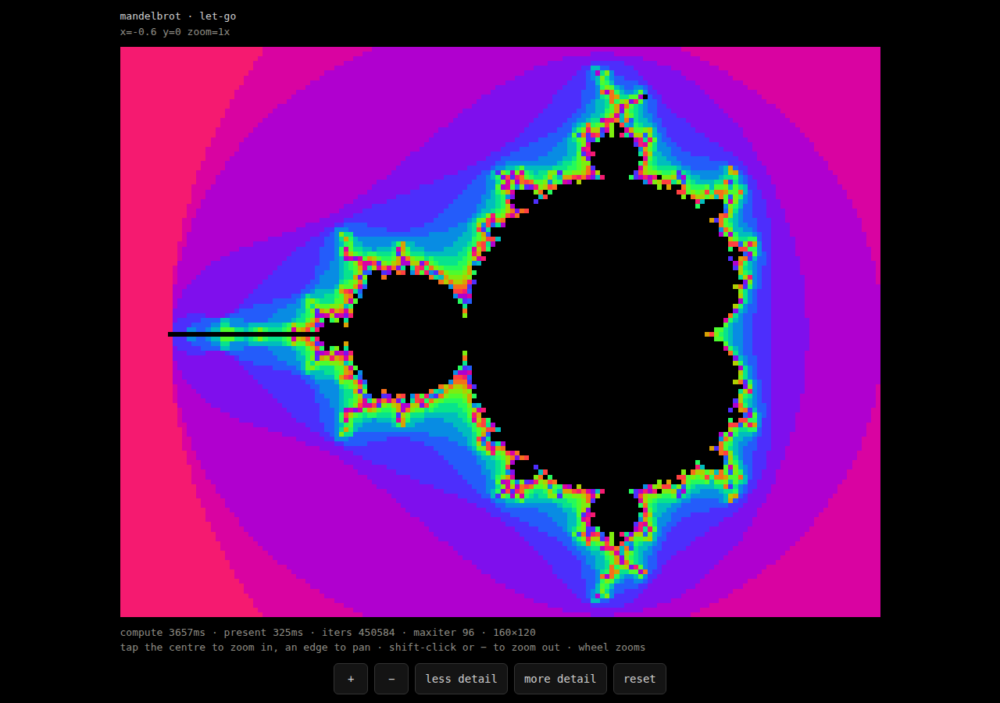
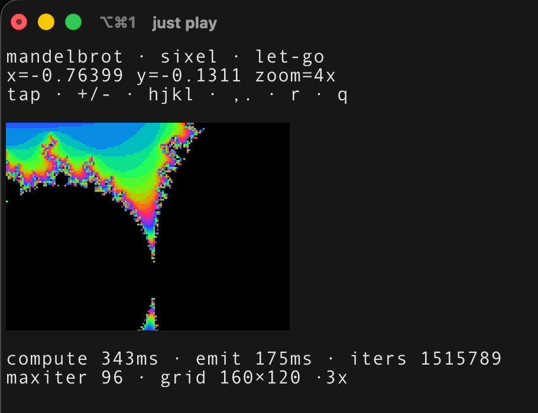

# let-go-lab

Experiments on [let-go](https://github.com/nooga/let-go) — sixel graphics,
terminal UI, wasm-in-the-browser — decoupled from any one client app.

**▶ Live in your browser, no install** (let-go compiled to WASM):
every demo is on [the lab's index page](https://matt.parrett.us/let-go-lab/):
[mandelbrot](https://matt.parrett.us/let-go-lab/mandelbrot/) ·
[pathtrace](https://matt.parrett.us/let-go-lab/pathtrace/) ·
[ptcanvas](https://matt.parrett.us/let-go-lab/ptcanvas/) ·
[microgpt sampler](https://matt.parrett.us/let-go-lab/microgpt/).



## Quick start

```sh
just play            # native TUI (needs a sixel-capable terminal)
just serve           # build + serve in the browser; open the printed URL
```

Both default to the `mandelbrot` demo and to the lg in the symlinked checkout
(`./let-go`) — use the let-go release pinned in
[`config/let-go-release`](config/let-go-release). See
[CLAUDE.md](CLAUDE.md) for the lg requirement, cert setup for LAN/phone serving,
and how to add a demo.

To compile a complete demo to a native executable:

```sh
just native mandelbrot       # also: pathtrace, microgpt
dist/native/mandelbrot
```

This optional build caches the audited let-go SHA from
[`config/let-go-native.sha`](config/let-go-native.sha). Browser CI and Pages
use the release pin. See [native builds](docs/native-builds.md) for requirements,
measurements, and compiler limitations.

## Demos

- **mandelbrot** — an escape-time Mandelbrot. In the browser it draws to a
  `<canvas>` (`surface/present`), sized to the window; in a terminal it draws
  sixel graphics. Interactive zoom / pan / maxiter, tap-to-recenter (a central
  tap zooms, an edge tap pans), a dim-while-computing cue, live phase timing,
  and a sixel encoder that works from the coarse grid.

  Controls: `+/-` zoom · `hjkl` / arrows pan · `,/.` maxiter · `r` reset ·
  `q` quit · wheel to zoom. Click/tap to recenter — a central tap zooms in, an
  edge tap only pans (shift+click zooms out) —
  exact in the browser (taps map straight to the canvas), and native too where
  the terminal's cell size can be measured (under tmux, or a terminal that
  answers the xterm window-ops), with keyboard pan/zoom as the fallback. The
  browser page adds buttons for touch.

  The same `.lg` runs natively in any sixel-capable terminal (`just play`):

  

  A link or flags can set the starting view, e.g.
  [`?x=-0.745&y=0.11&zoom=50`](https://matt.parrett.us/let-go-lab/mandelbrot/?x=-0.745&y=0.11&zoom=50)
  or `just play mandelbrot --zoom 50 --x -0.745 --y 0.11` (also `maxiter`).

- **[pathtrace](demos/pathtrace)** — a small progressive Monte Carlo path tracer
  that encodes its own PNG and shows it through the iTerm2 inline-image protocol,
  in xterm.js or natively in iTerm2. Each pass adds a sample per pixel, so the
  noise visibly settles. Controls: `hjkl` / arrows orbit · `n` next scene ·
  `r` reset · `q` quit; `--scene N` / `?scene=N` picks the starting scene.
  Headless runs render 32 samples/pixel and write `out.png`.
- **[ptcanvas](demos/ptcanvas)** — an allocation-free path tracer (scalars only,
  scene as flat arrays), ported from a JS original to test whether manual
  unboxing helps the let-go VM. Draws to a `<canvas>` in the browser
  (`just serve ptcanvas`); a non-TTY native run prints M paths/s.
- **[mandelbrot-aot](demos/mandelbrot-aot)** — the mandelbrot `escape` kernel
  lowered from `.lg` to native Go with `lg compile`, driven by a Go terminal
  renderer: same output as the VM, about 72× faster.

## Experiments

- **[aot](experiments/aot)** — the mandelbrot kernel lowered to native Go through
  `lg compile`, against the VM and a hand-written Go port.
- **[microgpt](experiments/microgpt)** — Karpathy's scalar GPT in one let-go
  file: train on the VM or natively, sample in the browser, and check numerical
  agreement with Python. Includes trained weights and reproducible timings.
- **[cueplay](experiments/cueplay)** — intro-then-gapless-loop cue player on
  oto, with no cgo: the prototype for let-go's native audio binding (nooga/let-go#255).
